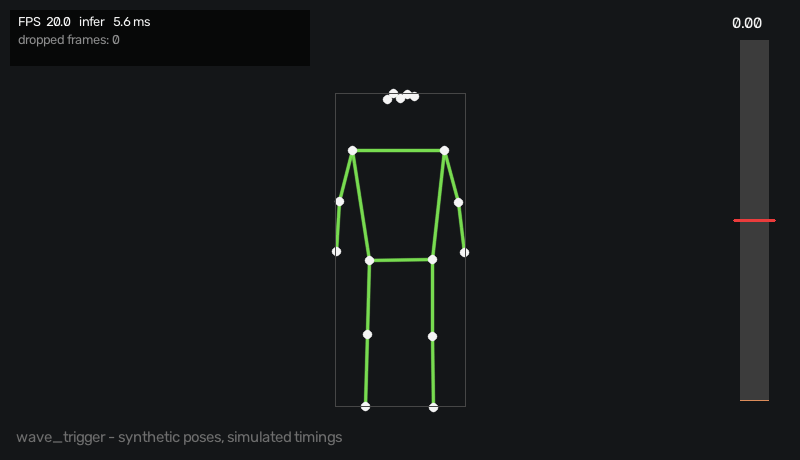

# wave-trigger

Detect a wave in a video stream and run any action you like.



Built on YOLO pose estimation. The gesture detector works out of the box with no
training and no weights; a small PyTorch classifier is available as an alternative.

## Install

```bash
pip install git+https://github.com/TommiBu/wave-trigger
```

The YOLO pose weights download automatically on first run.

## Use

Callback:

```python
from wave_trigger import WaveTrigger

WaveTrigger(on_wave=lambda event: print("hello world")).run()
```

Generator, when you want to keep the loop:

```python
from wave_trigger import WaveTrigger

with WaveTrigger() as trigger:
    for event in trigger.events():
        print(event)          # wave@12.34s score=0.87
```

Anything callable works as the action — play a sound, switch an OBS scene, send a
webhook, start a timer, write a timestamp to CSV.

Configuration:

```python
from wave_trigger import Config, WaveTrigger

cfg = Config(threshold=0.6, cooldown_s=2.0, window_seconds=2.0, imgsz=480)
WaveTrigger(on_wave=my_action, config=cfg).run()
```

A video file instead of the webcam: `WaveTrigger(source="clip.mp4")`.

## How it works

```
frames -> YOLO pose -> normalized features -> 2 s window -> detector -> event
```

- **Normalization** centres keypoints on the shoulder midpoint and divides by
  shoulder width or torso length, so the detector sees the gesture rather than
  where you stand or how far from the camera you are.
- **The window** is defined in seconds, not frames, and is resampled to a fixed
  number of steps — the same model runs on a machine with a different frame rate.
- **The detector** is a pure function of the window, so it can be replayed offline
  on recorded clips and scored reproducibly.
- **Cooldown** lives outside the detector, so one wave fires one event.

## Detectors

`rule` (default) requires the wrist above the shoulder and oscillating sideways,
counting direction changes with hysteresis so detector noise is not counted as
motion. No training data, no weights, works for anyone.

`torch` is a 1D CNN over the window (~8k parameters). It handles some negatives
better — a single reach up and down scores 0.21 under the rules and 0.002 under
the model — but it has to be trained on your own clips.

```python
from wave_trigger import Config, WaveTrigger

WaveTrigger(config=Config(detector="torch", weights="runs/wave.pt")).run()
```

## Train your own

```bash
python scripts/train.py --synthetic --overfit        # sanity check, no data needed
python scripts/train.py --synthetic --arch cnn       # full run on synthetic poses

python scripts/record_clips.py --label wave  --n 30
python scripts/record_clips.py --label other --n 60
python scripts/extract.py --in data/raw --out data/npz
python scripts/train.py --data data/npz --arch cnn --epochs 40 --device mps
python scripts/evaluate.py --data data/npz --sweep --postprocess
```

Put hard negatives in the `other` class — scratching your head, reaching for
something, stretching. The model learns the boundary between classes, and only
examples near it teach the boundary.

`evaluate.py` reports recall and false positives per minute, not accuracy;
with 97% of windows negative, accuracy rewards answering "no" forever.
`--postprocess` also runs non-causally, which shows how much better the same
detector looks when it is allowed to see the future.

## Tools

```bash
python scripts/bench.py                  # inference latency per device and imgsz
python examples/overlay_demo.py          # skeleton, score bar, live features
```

`overlay_demo.py` keys: `q` quit, `f` toggle feature values, `r` reset.

## Develop

```bash
pip install -e ".[dev]"
pytest
```

Tests use synthetic poses and a fake estimator, so they need neither a camera nor
the YOLO weights.

## License

Not chosen yet. Note that `ultralytics` is AGPL-3.0, which constrains what this
project can be released under.
